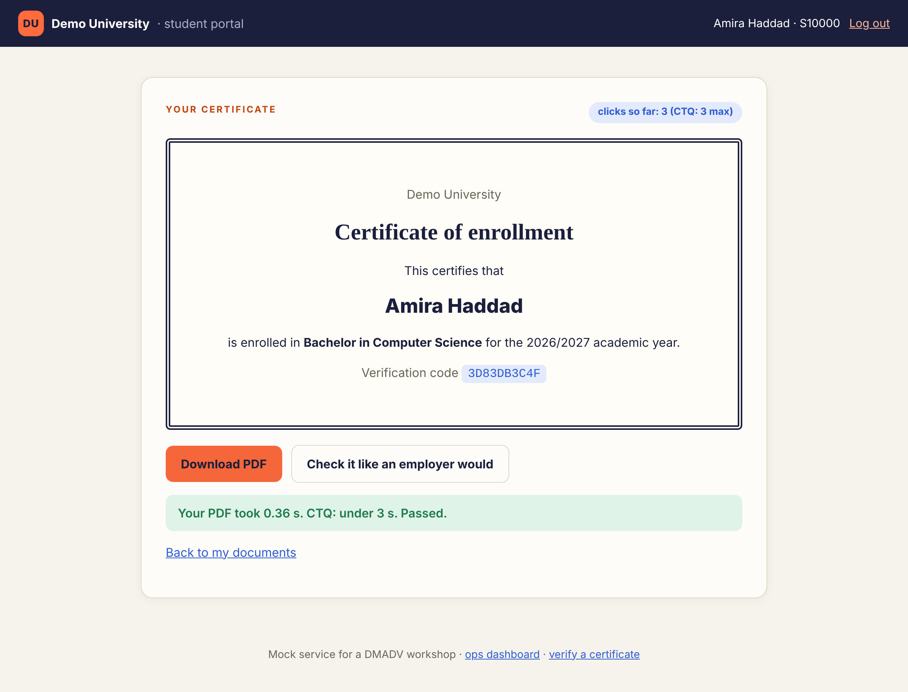
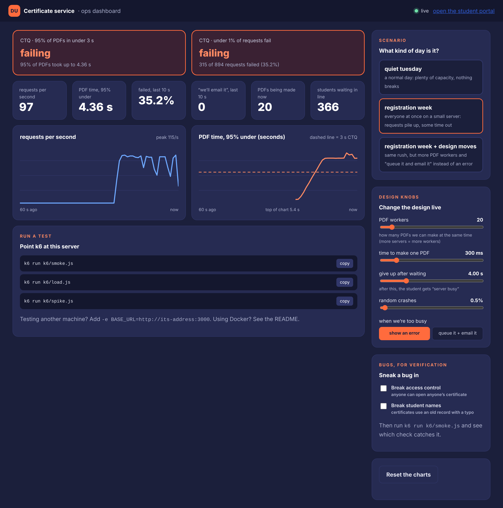
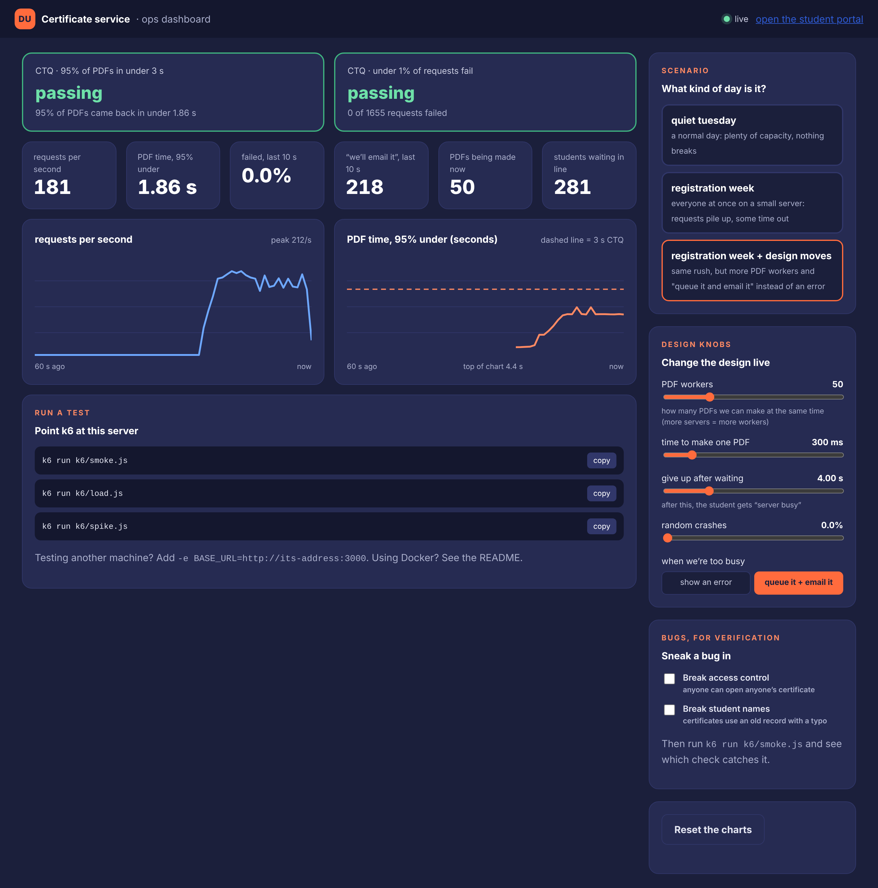

# Certificate Lab

A fake university certificate service you can **load-test in 5 minutes**.

Built for a Lean Six Sigma (DMADV) workshop: students click through a small portal to get their enrollment certificate, and you use [k6](https://grafana.com/docs/k6/latest/) to throw **500 fake students** at it and check whether it still meets its CTQs:

- 95% of PDFs come back in **under 3 seconds**
- **under 1%** of requests fail

A live dashboard shows the CTQs passing or failing while the test runs, and has knobs to change the design on the fly (more servers, "queue it and email it", random crashes, and two hidden bugs for practising verification).

| Student portal | Ops dashboard during "registration week" |
|---|---|
|  |  |

> Everything here is mock data for teaching. No real students, no real certificates.

---

## What you need

Pick **one** of these three ways to run it.

| | What to install | Best for |
|---|---|---|
| **A. Docker** | Docker Desktop | fastest setup, nothing else to install |
| **B. On your laptop** | Node.js 18+ and k6 | if you don't have Docker |
| **C. GitHub Codespaces** | nothing, just a GitHub account | if you can't install anything |

---

## A. Docker (fastest)

**1. Install Docker Desktop:** https://www.docker.com/products/docker-desktop/ (start it once so it's running).

**2. Get the code:**

```bash
git clone https://github.com/YOUR-USERNAME/certificate-lab.git
cd certificate-lab
```

No git? On the GitHub page click **Code → Download ZIP**, unzip it, and open a terminal in that folder.

**3. Start the service:**

```bash
docker compose up -d --build
```

Open these two pages in your browser:

- student portal: http://localhost:3000
- ops dashboard: http://localhost:3000/dashboard

**4. Run the tests** (k6 runs inside Docker too, nothing to install):

```bash
# quick check that everything works (1 student)
docker compose run --rm k6 run /scripts/smoke.js

# the big one: 500 students for 35 seconds
docker compose run --rm --service-ports k6 run /scripts/load.js
```

While the load test runs, watch the ops dashboard. k6 also opens its own live graphs at http://localhost:5665.

**5. Stop everything when you're done:**

```bash
docker compose down
```

---

## B. On your laptop (Node.js + k6)

**1. Install Node.js 18 or newer** (the LTS version is fine): https://nodejs.org

**2. Install k6:**

| System | Command |
|---|---|
| macOS | `brew install k6` |
| Windows | `winget install k6 --source winget` (or `choco install k6`) |
| Ubuntu / Debian | see the 4 commands below |
| Fedora | `sudo dnf install https://dl.k6.io/rpm/repo.rpm && sudo dnf install k6` |

Ubuntu / Debian:

```bash
curl -fsSL https://dl.k6.io/key.gpg | sudo gpg --dearmor -o /usr/share/keyrings/k6-archive-keyring.gpg
echo "deb [signed-by=/usr/share/keyrings/k6-archive-keyring.gpg] https://dl.k6.io/deb stable main" | sudo tee /etc/apt/sources.list.d/k6.list
sudo apt-get update
sudo apt-get install k6
```

Check that both work:

```bash
node -v      # v18 or higher
k6 version
```

**3. Start the service** (there's nothing to `npm install`, it has zero dependencies):

```bash
npm start
```

Leave that terminal open. Open http://localhost:3000 and http://localhost:3000/dashboard.

**4. In a second terminal, run the tests:**

```bash
k6 run k6/smoke.js     # 1 student, checks everything is correct
k6 run k6/load.js      # 500 students, checks the CTQs
k6 run k6/spike.js     # 1000 students show up in 5 seconds
```

Want k6's own live graphs? Turn on its web dashboard, then open http://localhost:5665:

```bash
# macOS / Linux
K6_WEB_DASHBOARD=true k6 run k6/load.js

# Windows PowerShell
$env:K6_WEB_DASHBOARD="true"; k6 run k6/load.js
```

Small laptop? Use fewer students: `k6 run -e STUDENTS=200 k6/load.js`

---

## C. GitHub Codespaces (nothing to install)

1. On the repo page, click **Code → Codespaces → Create codespace on main**.
2. Wait a minute or two. k6 gets installed for you automatically.
3. In the terminal, run `npm start`. A popup offers to open port 3000: that's the portal (add `/dashboard` to the URL for the dashboard).
4. Open a second terminal (the **+** button) and run `k6 run k6/load.js`.

---

## The three tests

| Test | Students | What it checks | Lean Six Sigma idea |
|---|---|---|---|
| `k6/smoke.js` | 1 | login works, the right document shows up, the name on the certificate matches the record, the PDF is a real PDF, employers can verify it, you can't open someone else's certificate, ineligible students get no button | **verification**: did we build it right? |
| `k6/load.js` | 500 for 35 s | 95% of PDFs under 3 s, under 1% failed | testing against **CTQs** |
| `k6/spike.js` | 1000 in 5 s | same CTQs, much nastier | designing for **noise** |

k6 exits with an error when a check or threshold fails, so a red ✗ in the output means the CTQ failed.

## The dashboard knobs

The three scenario buttons on the right of the dashboard set all the knobs at once. These are the results we got running `k6 run k6/load.js` (500 students) on a normal laptop:

| Scenario | What changes | 95% of PDFs under | Failed | CTQs |
|---|---|---|---|---|
| **quiet tuesday** | 60 PDF workers, 150 ms per PDF | ~0.4 s | 0% | ✅ pass |
| **registration week** | only 20 workers, 300 ms per PDF, a few random crashes, "server busy" after 4 s | ~4.3 s | ~23% | ❌ both fail |
| **registration week + design moves** | 50 workers, and when busy for 1.5 s: "we'll email it" instead of an error | ~1.9 s | 0% (about 550 students got the email instead) | ✅ pass |

Your numbers will be a bit different on your machine; that's normal.



You can also move each knob yourself:

- **PDF workers**: how many PDFs can be made at the same time. More servers = more workers.
- **time to make one PDF**: how slow the PDF generator is.
- **give up after waiting**: after this, the student gets "server busy" (a failed request).
- **random crashes**: percentage of PDFs that fail for no reason.
- **when we're too busy**: show an error, or queue it and email the certificate later (a design move).

And two **bugs** you can sneak in, then catch with `k6/smoke.js`:

- **break access control**: anyone can open anyone's certificate.
- **break student names**: certificates use an old record with a typo.

## Things to try

1. Be a student first: open http://localhost:3000, log in as `S10000`, get your certificate. The badge counts your clicks against the "3 clicks max" CTQ.
2. Run `smoke.js`. Everything should be green.
3. Run `load.js` on **quiet tuesday**. Passes.
4. Switch to **registration week** and run it again. Watch both CTQ boxes turn red.
5. Switch to **registration week + design moves**. Green again. Why?
6. Tick one of the bugs, run `smoke.js`, and find which check catches it.
7. Find the breaking point: on registration week, how many workers do you need before `load.js` passes?
8. Edit the thresholds in `k6/load.js` (for example `p(95)<1000`). Does the design still pass a stricter CTQ?
9. Run `spike.js` on **design moves**. It passes, but check `emailed_instead_of_error` at the end. If thousands of students got "we'll email it", did the design *really* pass? (k6 checks the spec. Only real students can tell you if that's acceptable.)

## Running it for a whole room

To let other people open your portal and dashboard from their laptops (same Wi-Fi):

```bash
# macOS / Linux
HOST=0.0.0.0 ADMIN_KEY=pick-a-password npm start

# Windows PowerShell
$env:HOST="0.0.0.0"; $env:ADMIN_KEY="pick-a-password"; npm start

# Docker
ADMIN_KEY=pick-a-password docker compose up -d --build
```

The terminal prints the address to share (like `http://192.168.1.20:3000`). With `ADMIN_KEY` set, only people who type the key into the dashboard can turn the knobs.

To test someone else's server: `k6 run -e BASE_URL=http://192.168.1.20:3000 k6/load.js`

> Heads up: if 30 people load-test one laptop at the same time, it *will* fall over. That's a fun demo on purpose, but for the exercises everyone should run their own copy.

## Troubleshooting

| Problem | Fix |
|---|---|
| `port 3000 is already in use` | Run on another port: `PORT=3001 npm start` (PowerShell: `$env:PORT="3001"; npm start`), then use `-e BASE_URL=http://localhost:3001` with k6. |
| `k6: command not found` | Close and reopen the terminal after installing. Or use the Docker way, which needs no k6 install. |
| k6 says `connection refused` | The service isn't running. Start it with `npm start` (or `docker compose up -d`) first. |
| Docker: k6 can't reach `localhost` | Inside Docker, the service is called `app`. The compose file already sets `BASE_URL=http://app:3000` for you. |
| Running k6 in Docker against a service on your laptop (not in Docker) | `docker run --rm -i -e BASE_URL=http://host.docker.internal:3000 grafana/k6 run - <k6/load.js` |
| The load test is slow or fails on quiet tuesday | Your machine is busy. Try `-e STUDENTS=200`. |

## What's in here

```
server.js            the mock service (Node.js, zero dependencies)
public/              the student portal, verify page and ops dashboard
k6/smoke.js          1 student, correctness checks (verification)
k6/load.js           500 students, CTQ thresholds
k6/spike.js          1000 students in 5 seconds
Dockerfile           image for the service
docker-compose.yml   the service + k6, ready to go
.devcontainer/       GitHub Codespaces setup (installs k6)
WORKSHOP.md          the facilitator's script
```

### API, if you want to write your own tests

| Method | Path | What it does |
|---|---|---|
| POST | `/api/login` | body `{"studentId":"S10000"}`, sets a session cookie |
| GET | `/api/me` | the logged-in student |
| GET | `/api/documents` | documents for that student |
| GET | `/api/certificates/:id` | certificate data (403 if it's not yours) |
| GET | `/api/certificates/:id/pdf` | the PDF: the slow, limited part. 200 = PDF, 202 = queued, 503 = busy, 500 = crash |
| GET | `/api/verify/:code` | is this verification code real? |
| GET | `/api/stats` | numbers behind the dashboard |
| POST | `/api/settings` | change the knobs, e.g. `{"workers":40}` |
| POST | `/api/settings/preset/:name` | `quiet-tuesday`, `registration-week`, `design-moves` |

Student IDs go from `S10000` to `S11999`. IDs ending in 9 are not eligible for a certificate, on purpose.

## License

MIT. Use it, change it, run it in your own class.
